

📄 CVision · Analizador de CVs con IA

Compara tu currículum con una vacante y obtén compatibilidad, fortalezas y mejoras concretas.

FastAPI PostgreSQL Gemini Render

🌐 Aplicación en línea · 📚 Documentación de la API

 <!-- 📸 CAPTURA 1 (banner / portada) Qué capturar: la pantalla de resultados de un análisis (porcentaje + desglose), recortada a lo ancho. Guárdala como: docs/img/01-portada.png --> 
 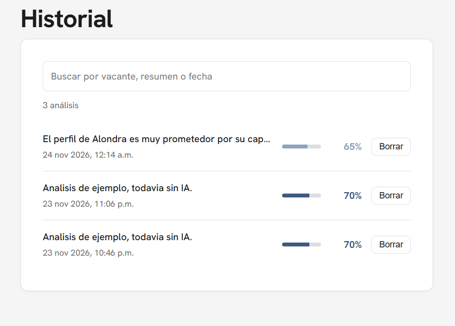 

⏳ Nota: el plan gratuito de Render duerme el servicio tras unos 15 minutos sin uso. La primera petición puede tardar cerca de un minuto en responder.

📑 Contenido
Descripción
Características
Capturas de pantalla
Tecnologías
Arquitectura
API
Formato del análisis
Ejecutar en local
Variables de entorno
Guía de despliegue en Render
Solución de problemas
Privacidad
Equipo
📝 Descripción

CVision es una aplicación web que analiza un currículum en PDF frente a una oferta de trabajo. Con ayuda de inteligencia artificial (Google Gemini) calcula el porcentaje de compatibilidad y entrega un informe con lo que ya funciona, lo que falta y qué editar en el CV, con ejemplos de antes y después.

Proyecto final en equipo: front-end, back-end con login de usuarios, integración con IA y despliegue en la nube.

✨ Características
🔐 Registro e inicio de sesión con contraseñas cifradas y tokens JWT.
📤 Subida de CV en PDF junto con el texto de la vacante.
🎯 Porcentaje de compatibilidad con desglose por habilidades, experiencia, formación y palabras clave.
🏷️ Palabras clave presentes y faltantes, mostradas como etiquetas.
💪 Fortalezas y debilidades lado a lado.
✏️ «Qué editar en tu CV»: tarjetas por sección con prioridad (alta, media o baja), problema, recomendación y ejemplo antes/después.
🗺️ Plan de acción ordenado paso a paso.
🕘 Historial de análisis con búsqueda, consulta de detalle y borrado.
👤 Cada usuario solo ve y borra sus propios análisis.
🖼️ Capturas de pantalla
Inicio de sesión y registro
<!-- 📸 CAPTURA 2 Qué capturar: pantalla de login/registro (sin datos reales escritos). Guárdala como: docs/img/02-login.png --> 
 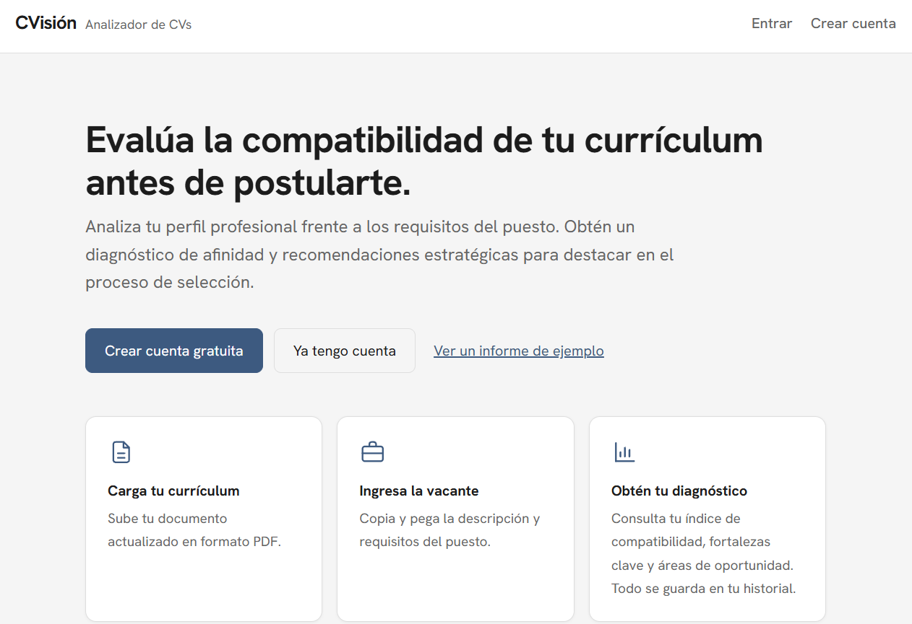 

Subir CV y vacante
<!-- 📸 CAPTURA 3 Qué capturar: pantalla de análisis con el PDF seleccionado y el texto de la oferta pegado. Guárdala como: docs/img/03-subir-cv.png --> 
 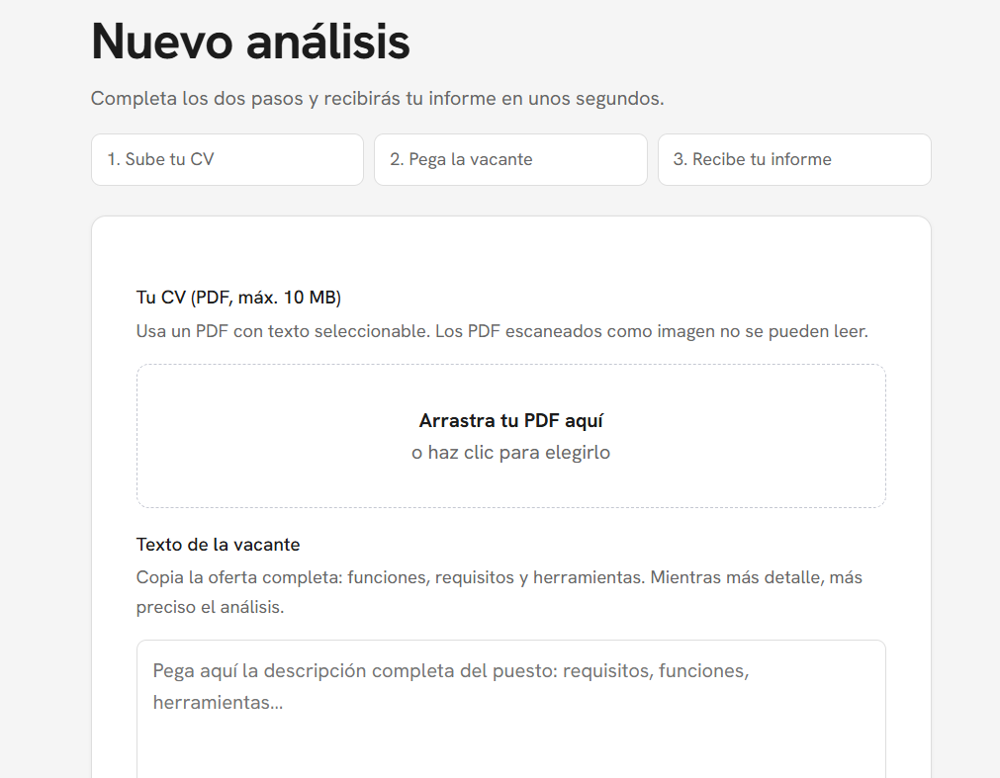 

Informe de compatibilidad
<!-- 📸 CAPTURA 4 Qué capturar: parte superior del informe: porcentaje, resumen y desglose con barras. Guárdala como: docs/img/04-informe-compatibilidad.png --> 
 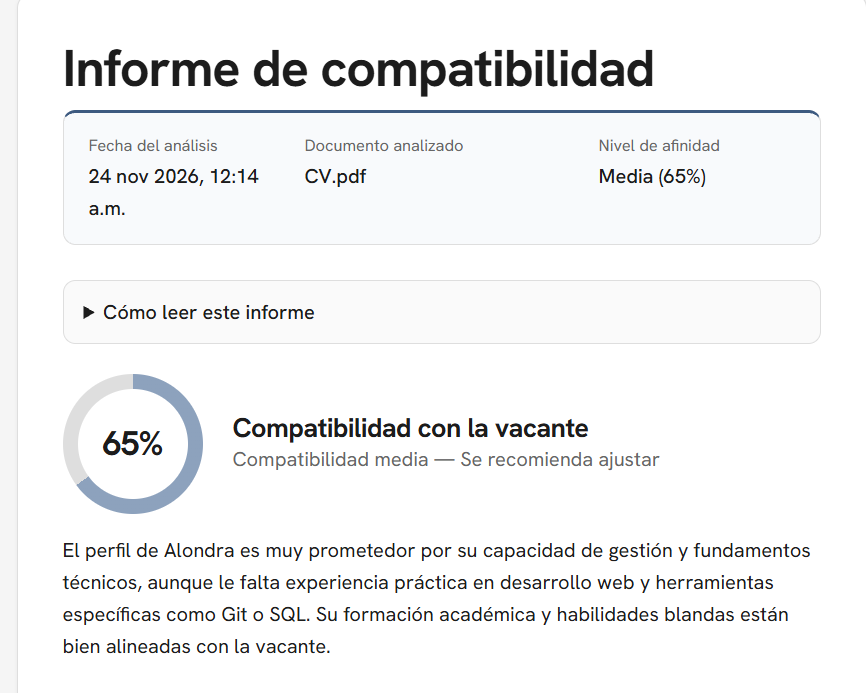 

Desglose por área y palabras clave
<!-- 📸 CAPTURA 5 Qué capturar: barras de «Desglose por área» y etiquetas «Ya aparecen en tu CV» / «Faltan en tu CV». Guárdala como: docs/img/05-desglose-palabras.png --> 
 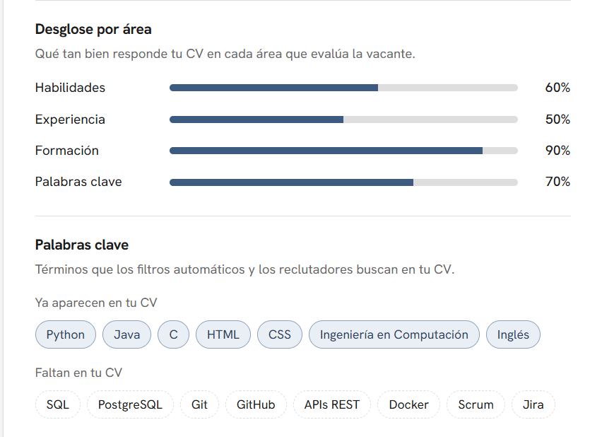 

Fortalezas y debilidades
<!-- 📸 CAPTURA 5B Qué capturar: las columnas de Fortalezas y Debilidades. Guárdala como: docs/img/05b-fortalezas-debilidades.png --> 
 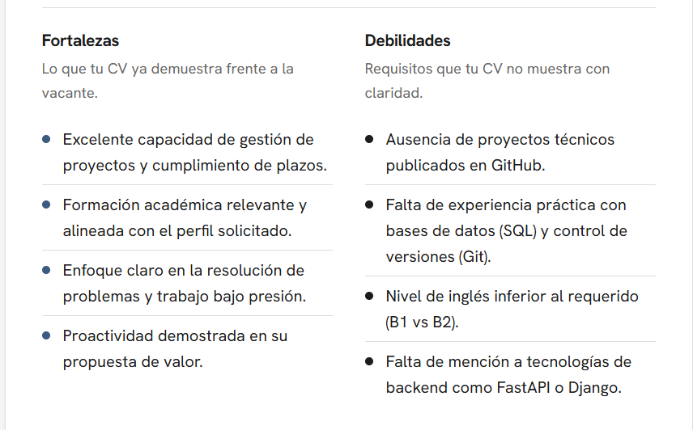 

Qué editar en tu CV y plan de acción
<!-- 📸 CAPTURA 6 Qué capturar: dos o tres tarjetas de «Qué editar en tu CV» (con antes/después) y el plan de acción numerado. Guárdala como: docs/img/06-editar-plan.png --> 
 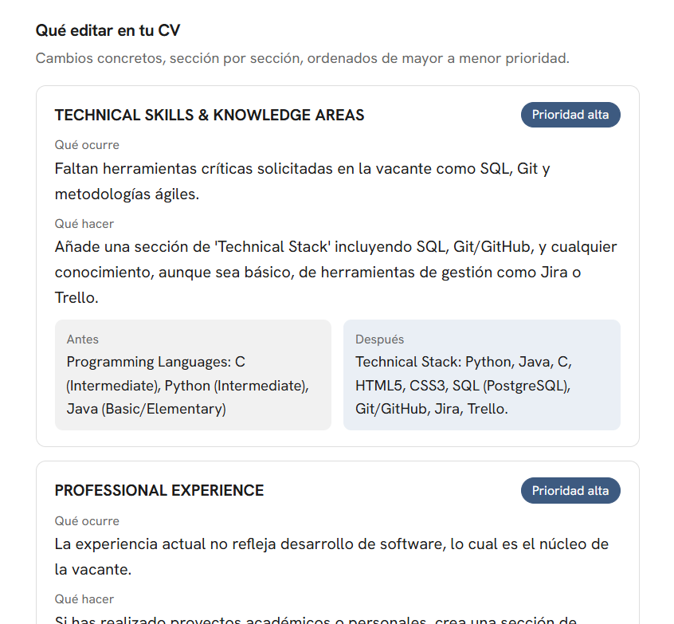 

Historial
<!-- 📸 CAPTURA 7 Qué capturar: pestaña Historial con la caja de búsqueda y varios renglones (título, fecha, barra y botón Borrar). Guárdala como: docs/img/07-historial.png --> 
 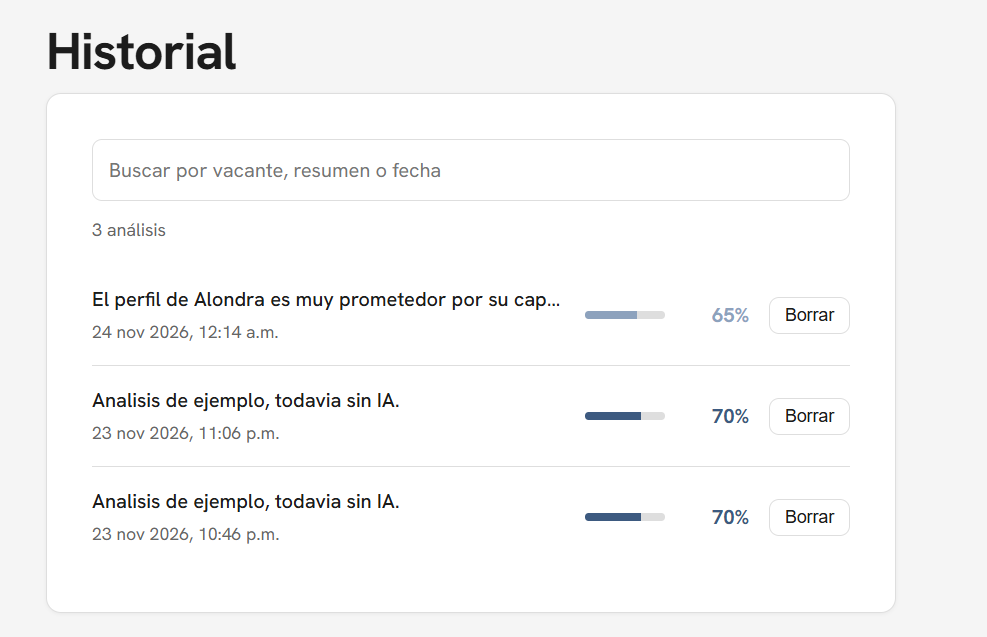 

Documentación interactiva de la API
<!-- 📸 CAPTURA 8 Qué capturar: https://analizador-cvs.onrender.com/docs con todas las rutas visibles (incluido DELETE /analyses/{id}). Guárdala como: docs/img/08-swagger.png --> 
  

🧰 Tecnologías
Capa	Tecnología
Front-end	HTML, CSS y JavaScript (sitio estático en Render)
Back-end	Python, FastAPI, SQLModel
Base de datos	SQLite (local) · PostgreSQL (Render)
Autenticación	JWT y contraseñas cifradas
Lectura de PDF	pdfplumber
Inteligencia artificial	Google Gemini API
Despliegue	Render
🏗️ Arquitectura
<!-- 📸 DIAGRAMA (opcional) Qué capturar/crear: un esquema simple Front-end → API FastAPI → Gemini, y API → PostgreSQL. Puedes hacerlo en draw.io o Excalidraw. Guárdalo como: docs/img/09-arquitectura.png --> 
  

Navegador (front-end)
        │  HTTPS + JWT
        ▼
API FastAPI (Render) ──► PostgreSQL (Render)
        │
        ▼
   Google Gemini
Estructura del repositorio
analizador-cvs/
├── backend/
│   ├── app/
│   │   ├── main.py       # Aplicación, CORS y rutas de autenticación
│   │   ├── analisis.py   # Rutas de análisis e historial
│   │   ├── ia.py         # Conexión con Gemini
│   │   ├── auth.py       # Contraseñas cifradas y tokens JWT
│   │   ├── database.py   # Conexión a la base de datos
│   │   └── models.py     # Tablas y formatos de la API
│   └── requirements.txt
├── frontend/             # Interfaz web
├── docs/                 # Reporte, presentación e imágenes (docs/img)
└── README.md
🔌 API

URL base: https://analizador-cvs.onrender.com

Método	Ruta	Descripción	Requiere login
POST	/auth/register	Crea un usuario	No
POST	/auth/login	Inicia sesión y devuelve un token JWT	No
GET	/auth/me	Datos del usuario autenticado	Sí
POST	/analyses	Sube un CV (PDF) y una vacante y devuelve el análisis	Sí
GET	/analyses	Historial de análisis del usuario	Sí
GET	/analyses/{id}	Detalle de un análisis	Sí
DELETE	/analyses/{id}	Borra un análisis (solo de su dueño)	Sí

Las rutas protegidas necesitan el encabezado:

Authorization: Bearer <token>
🧠 Formato del análisis de la IA

La IA devuelve un JSON con estas claves. Se guarda completo y se entrega igual en POST /analyses, GET /analyses y GET /analyses/{id}, junto con el campo archivo (nombre del CV subido).

json
{
  "match_percentage": 68,
  "summary": "Tu perfil cubre bien la parte técnica, pero faltan resultados medibles y Power BI.",
  "breakdown": { "skills": 72, "experience": 64, "education": 85, "keywords": 55 },
  "matched_keywords": ["Excel", "SQL", "Análisis de datos"],
  "missing_keywords": ["Power BI", "KPI", "Visualización de datos"],
  "strengths": ["Formación afín a la vacante.", "Experiencia con SQL."],
  "weaknesses": ["No aparece ninguna herramienta de visualización."],
  "suggestions": ["..."],
  "section_feedback": [
    {
      "section": "Resumen profesional",
      "priority": "alta",
      "issue": "El texto es genérico.",
      "recommendation": "Menciona el puesto y tus herramientas clave.",
      "example_before": "Persona responsable y proactiva.",
      "example_after": "Analista de datos con experiencia en SQL y Excel…"
    }
  ],
  "action_plan": ["Paso 1", "Paso 2"]
}

priority solo puede ser alta, media o baja.

💻 Ejecutar el back-end en local

Requisitos: Python 3.12 o superior y Git.

bash
# 1. Clonar el repositorio
git clone https://github.com/luistunas7874-droid/analizador-cvs.git
cd analizador-cvs/backend

# 2. Crear y activar el entorno virtual (Windows)
python -m venv venv
venv\Scripts\activate

# 3. Instalar las dependencias
pip install -r requirements.txt
Crea un archivo .env dentro de backend (ver variables de entorno). Para generar una SECRET_KEY segura:
bash
python -c "import secrets; print(secrets.token_hex(32))"
Arranca el servidor:
bash
uvicorn app.main:app --reload

Abre http://127.0.0.1:8000/docs para probar la API. Se crea el archivo analizador.db (SQLite) automáticamente.

🔑 Variables de entorno
Variable	Obligatoria	Descripción
SECRET_KEY	Sí	Clave larga y aleatoria para firmar los tokens JWT
DATABASE_URL	En la nube	URL de PostgreSQL. Si no existe, se usa SQLite
GEMINI_API_KEY	Sí	Clave de la API de Gemini (aistudio.google.com/apikey)
GEMINI_MODEL	Recomendada	Modelo de Gemini a usar, sin el prefijo models/
CORS_ORIGINS	En la nube	URL(s) del front-end permitidas, separadas por comas

⚠️ Nunca subas claves ni el archivo .env a GitHub. Deben vivir solo en tu .env local (ignorado por .gitignore) y en las variables de entorno de Render.

☁️ Guía de despliegue en Render
1. Crear la base de datos PostgreSQL
Crea una cuenta en render.com con tu cuenta de GitHub.
Pulsa New → Postgres.
Nómbrala analizador-db, elige una región (por ejemplo Ohio) y el plan Free.
Pulsa Create Database y espera a que el estado sea Available.
Copia la Internal Database URL.

Las bases gratuitas de Render caducan 30 días después de crearse.

<!-- 📸 CAPTURA 10 Qué capturar: la base analizador-db en Render con estado Available (oculta cualquier URL o contraseña). Guárdala como: docs/img/10-render-db.png --> 
 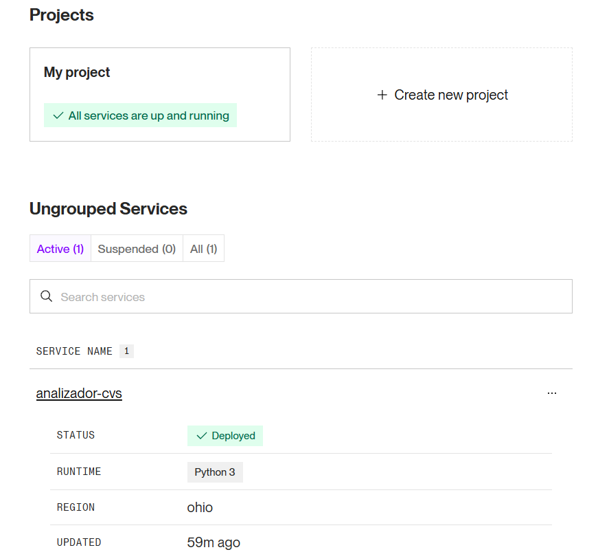 

2. Crear el servicio web
Pulsa New → Web Service y conecta el repositorio analizador-cvs.
Configura:
Campo	Valor
Name	analizador-cvs
Region	La misma que la base de datos
Branch	main
Root Directory	backend
Build Command	pip install -r requirements.txt
Start Command	uvicorn app.main:app --host 0.0.0.0 --port $PORT
Instance Type	Free
3. Variables de entorno

En Environment agrega DATABASE_URL, SECRET_KEY, GEMINI_API_KEY, GEMINI_MODEL y CORS_ORIGINS (ver la tabla).

<!-- 📸 CAPTURA 11 Qué capturar: la sección Environment con los NOMBRES de las variables. IMPORTANTE: tapa o difumina los valores (claves y URLs de base de datos). Guárdala como: docs/img/11-render-env.png --> 
 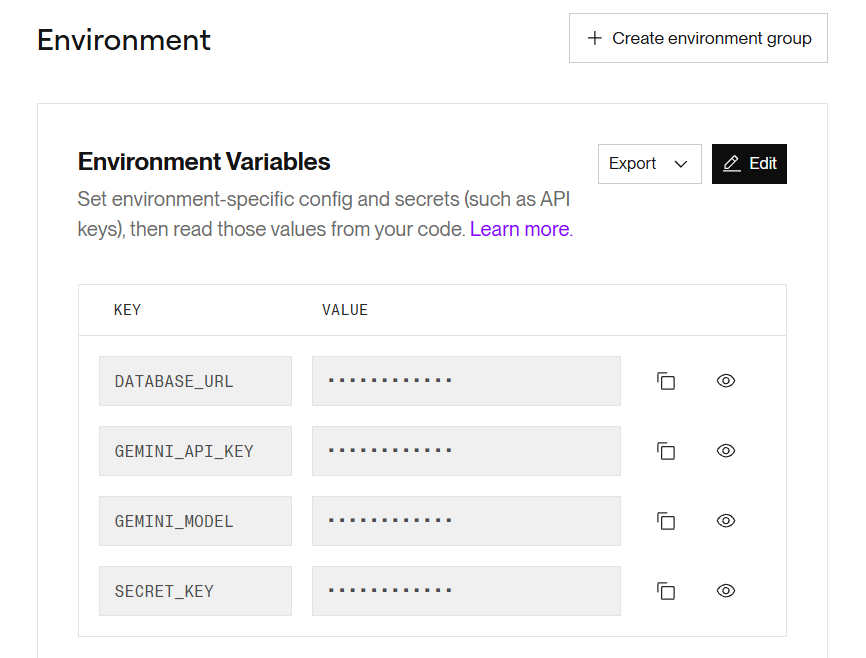 

4. Desplegar

Pulsa Create Web Service. Cuando el log diga Your service is live, abre la URL seguida de /docs para comprobar que funciona. Cada cambio unido a main se despliega automáticamente.

<!-- 📸 CAPTURA 12 Qué capturar: pestaña Events del servicio con «Deploy live». Guárdala como: docs/img/12-render-deploy.png --> 
 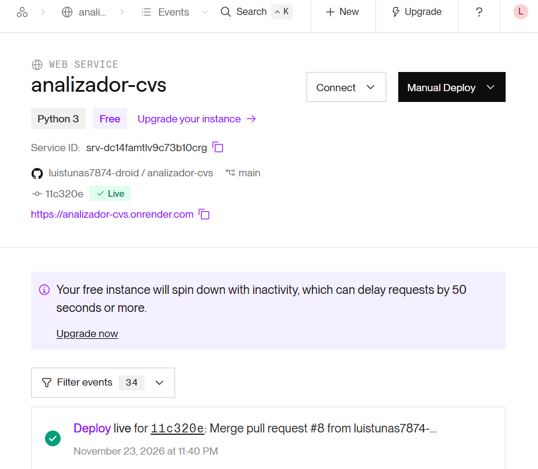 

5. Publicar el front-end

El front-end se publica como sitio estático en Render. Una vez que tenga su URL, agrégala a CORS_ORIGINS en el servicio del back-end para que el navegador pueda comunicarse con la API.

🛠️ Solución de problemas
Síntoma	Causa probable	Solución
«Error del servicio de IA (404)»	El modelo de Gemini fue retirado o no existe	Cambia GEMINI_MODEL en Render por un modelo vigente de la lista de Google
«La IA no responde»	Modelo saturado (503), límite de uso (429) o tiempo agotado	Prueba otro modelo Flash en GEMINI_MODEL o reintenta más tarde
Error de CORS en el navegador	La URL del front-end no está permitida	Agrégala a CORS_ORIGINS y espera el deploy
La primera petición tarda mucho	El plan gratuito de Render se durmió	Espera hasta un minuto y reintenta
No aparecen los botones Borrar	El back-end desplegado no tiene DELETE /analyses/{id}	Revisa /docs y confirma que Render desplegó el último commit

Para listar los modelos disponibles con tu clave (ejecútalo solo en tu computadora, sin compartir la clave):

powershell
$k = "TU_CLAVE"
(Invoke-RestMethod "https://generativelanguage.googleapis.com/v1beta/models" -Headers @{"x-goog-api-key"=$k}).models |
  Where-Object { $_.supportedGenerationMethods -contains "generateContent" } |
  Select-Object -ExpandProperty name
🔒 Privacidad

El texto de los CVs se envía a la API de Google Gemini para generar el análisis. En el plan gratuito, Google puede usar esos datos para mejorar sus productos, por lo que no subas CVs de otras personas ni información sensible.

👥 Equipo
Integrante	Responsabilidad
Luis Andres Tuñas Esparza	Back-end, base de datos y despliegue
Yocelyn	Front-end
Victoria	Integración con la IA

Hecho con ☕ para el proyecto final · CUCEI, Universidad de Guadalajara

